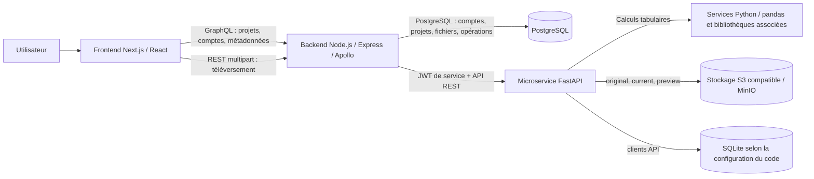
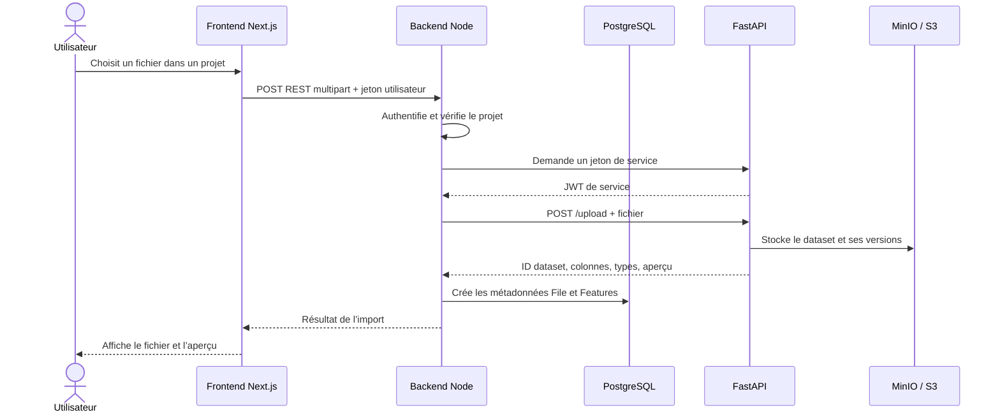

# Rapport de stage — DataSense Pro

> **Document de travail à personnaliser** : compléter les champs entre crochets (identité, établissement, entreprise, dates, encadrants) et adapter les formulations à la mission réellement effectuée. Ce rapport décrit les fonctionnalités et l’architecture visibles dans le dépôt du projet ; il ne prétend pas attribuer à une personne des travaux qui ne sont pas documentés dans le code.

## Page de garde

**Sujet :** Conception et développement d’une plateforme web de préparation et d’analyse de données — DataSense Pro  
**Stagiaire :** [Prénom NOM]  
**Établissement / formation :** [Nom de l’établissement et formation]  
**Organisme d’accueil :** [Nom de l’organisme]  
**Encadrant professionnel :** [Nom]  
**Encadrant pédagogique :** [Nom]  
**Période du stage :** [Date de début – date de fin]  
**Année universitaire :** [Année]

---

## Remerciements

Je remercie [nom de l’organisme] de m’avoir accueilli dans le cadre de ce stage. J’adresse également mes remerciements à [encadrant professionnel], pour son accompagnement, ses conseils et le suivi du projet, ainsi qu’à [encadrant pédagogique] et à l’équipe pédagogique pour leur soutien. Enfin, je remercie les personnes ayant contribué aux échanges, aux retours fonctionnels et à la validation des besoins autour de DataSense Pro.

## Résumé

DataSense Pro est une application web destinée à organiser des projets et des fichiers de données, puis à préparer, transformer et analyser ces données. Le projet repose sur trois parties principales : une interface web réalisée avec Next.js et React, un backend applicatif Node.js/TypeScript exposant une API GraphQL et des routes REST, et un microservice de calcul développé avec FastAPI et Python.

Le backend Node gère principalement les utilisateurs, les rôles et permissions, les projets, les fichiers et leurs métadonnées. Il sert également de passerelle vers FastAPI. Le microservice FastAPI fournit les fonctions de calcul portant sur les datasets : import et conversion, profilage, correction de types, gestion des valeurs manquantes et aberrantes, déduplication, transformations, filtrage, échantillonnage, tableaux croisés et fusion de fichiers. Les métadonnées applicatives sont gérées séparément des fichiers tabulaires : les premières sont conservées dans la base relationnelle du backend, tandis que les versions des datasets sont stockées dans un stockage compatible S3/MinIO.

Ce rapport présente le besoin, l’architecture, les principales fonctionnalités des API FastAPI, les responsabilités du backend et du frontend, ainsi que les relations et les flux de données entre ces composants. Il se termine par un bilan, des limites identifiées et des pistes d’amélioration.

**Mots-clés :** préparation de données, FastAPI, Python, Node.js, GraphQL, Next.js, pandas, PostgreSQL, MinIO, API REST.

## Table des matières

1. Introduction
2. Présentation et objectifs du projet
3. Architecture générale
4. Microservice FastAPI — fonctions et API
5. Backend Node.js — responsabilités et relations
6. Frontend Next.js — interfaces et intégration
7. Modèle de données et flux de traitement
8. Sécurité et gestion des erreurs
9. Méthode de travail et bilan technique
10. Limites et recommandations
11. Conclusion
12. Annexes : principales routes FastAPI

---

## 1. Introduction

Les organisations recueillent souvent des données dans des fichiers CSV ou Excel avant de pouvoir les exploiter. Ces données peuvent contenir des valeurs manquantes, des doublons, des types incorrects, des valeurs aberrantes ou des structures hétérogènes. Leur préparation demande alors plusieurs opérations et un suivi fiable des fichiers et de leurs versions.

DataSense Pro répond à ce besoin par une application qui réunit la gestion des projets et fichiers, ainsi qu’un ensemble d’opérations de préparation et d’analyse. L’objectif technique est de séparer l’interface utilisateur, les règles métier et les traitements de données afin de rendre l’application modulaire : le frontend dialogue avec le backend Node, et celui-ci délègue les calculs spécialisés au microservice Python.

Le présent rapport s’appuie sur l’organisation et les implémentations visibles dans le dépôt. Il décrit l’état du code, sans supposer que chaque fonctionnalité a été déployée ou validée en production.

## 2. Présentation et objectifs du projet

### 2.1 Objectif général

Mettre à disposition une plateforme permettant à un utilisateur autorisé de créer ou rejoindre un projet, d’y téléverser des fichiers, d’examiner leurs caractéristiques et d’appliquer des opérations de préparation à un jeu de données.

### 2.2 Objectifs fonctionnels

- gérer les comptes utilisateur, les rôles et les droits d’accès ;
- organiser les fichiers dans des projets ;
- importer des fichiers CSV et Excel et présenter un aperçu des données ;
- analyser la structure des colonnes, leurs types et les valeurs manquantes ;
- proposer des corrections ou transformations adaptées ;
- permettre des opérations sur les lignes, colonnes et jeux de données ;
- conserver les versions du jeu de données et prévisualiser les changements ;
- réaliser des analyses complémentaires, telles que l’échantillonnage, les tableaux croisés et la fusion de fichiers.

### 2.3 Objectifs techniques

- structurer le backend métier en modules ;
- isoler les traitements de données dans un service FastAPI ;
- valider les entrées d’API et uniformiser les réponses ;
- distinguer les métadonnées des données tabulaires volumineuses ;
- protéger les appels entre les services par un jeton de service ;
- proposer une interface web consommant GraphQL et REST.

## 3. Architecture générale

Le système est constitué de trois applications et de plusieurs stockages complémentaires.

### 3.1 Frontend

Le dossier `frontend-mantine-tailwind` contient une application Next.js 14 en TypeScript, avec React, Mantine, Tailwind CSS, Apollo Client et Axios. Les pages sont organisées avec le routeur Pages de Next.js. Les composants métier sont regroupés par domaines (projets, fichiers, transformations, échantillonnage, qualité, widgets, etc.).

### 3.2 Backend applicatif

Le dossier `backend` contient une application Node.js en TypeScript basée sur Express et Apollo Server. GraphQL est utilisé pour les opérations métier et les ressources gérées par les modules applicatifs. Les routes REST servent notamment au téléversement. Le backend conserve les métadonnées et réalise les contrôles d’accès avant d’appeler le service de calcul.

### 3.3 Microservice de calcul

Le dossier `fast-api-micro-services` contient une API Python construite avec FastAPI. Les routeurs décrivent les endpoints HTTP, les schémas Pydantic valident les données échangées, et les services Python exécutent les opérations. FastAPI est conçu comme un service spécialisé de calcul et de manipulation de datasets, plutôt que comme le backend principal de l’application.

### 3.4 Stockages

Le code distingue trois usages :

- **PostgreSQL côté Node** : données métier telles que les comptes, projets, fichiers, rôles, permissions et métadonnées de traitements ;
- **MinIO ou stockage compatible S3** : contenu tabulaire des jeux de données et versions de travail ;
- **SQLite côté FastAPI** : base déclarée dans le code Python pour les clients API du microservice.

Cette séparation permet de ne pas placer tout le contenu tabulaire volumineux dans les tables relationnelles utilisées par l’application.

## 4. Microservice FastAPI — fonctions et API

FastAPI constitue le cœur des traitements analytiques. Les endpoints sont déclarés dans `fast-api-micro-services/routers/`, et les calculs sont délégués aux modules correspondants de `services/`. Les schémas du dossier `schemas/` décrivent les données attendues et les réponses. La majorité des routes, hormis la santé et l’obtention d’un jeton, est protégée par la dépendance `verify_token` enregistrée dans `main.py`.

### 4.1 Démarrage, validation et réponses

Le point d’entrée initialise l’application FastAPI, enregistre les routeurs, charge la configuration d’environnement, initialise les structures de stockage et crée les tables de la base configurée. Il centralise également la gestion des erreurs : les erreurs HTTP, les erreurs de validation et les erreurs inattendues sont renvoyées sous une forme JSON commune. La validation invalide conduit notamment à un statut HTTP 422 ; les erreurs non traitées sont journalisées et retournent un statut 500 sans exposer le détail interne au client.

Les réponses fonctionnelles utilisent un schéma commun de succès/échec, ce qui facilite leur interprétation par le backend appelant.

### 4.2 Authentification du service

L’endpoint `POST /auth/token` vérifie les identifiants d’un client API et délivre un JWT de service. Le backend Node récupère ce jeton, puis l’envoie dans les appels FastAPI. La dépendance d’authentification vérifie le jeton avant de laisser exécuter les opérations protégées.

Il s’agit d’une authentification **entre services** : le microservice reconnaît le backend appelant. L’utilisateur final et ses permissions sur un projet doivent être contrôlés en amont par le backend Node.

### 4.3 Import, conversion et découverte d’un fichier

Les routes `POST /upload` et `POST /convert` acceptent des fichiers et couvrent l’import CSV/Excel ou la conversion d’un classeur vers un format exploitable par le pipeline. Lors d’un upload, le service lit le fichier, construit un dataset, déduit des métadonnées de base — notamment les colonnes, types et valeurs manquantes — puis renvoie un identifiant et un aperçu.

Les routes de fichiers complètent ce parcours :

- `POST /files/convert-to-json` convertit un contenu tabulaire pour sa consultation ;
- `GET /files/{file_id}/preview` récupère un aperçu ;
- `GET /files/{file_id}/current` récupère la version courante ;
- `GET /files/{file_id}/columns` et `GET /files/{file_id}/dtypes` renvoient la structure et les types ;
- `GET /files/{file_id}/has-preview` indique si une prévisualisation existe ;
- `POST /files/{file_id}/save-preview` valide/enregistre une version de prévisualisation selon le flux applicatif.

### 4.4 Gestion des versions du dataset

Le cycle des versions s’appuie sur les routes `POST /dataset/apply-preview` et `POST /dataset/cancel-preview`. Le stockage distingue typiquement les objets `original`, `current` et `preview` pour chaque identifiant de dataset :

- **original** conserve la version initiale importée ;
- **current** représente la version active ;
- **preview** représente le résultat temporaire d’une opération.

Une transformation peut donc être examinée avant validation. En cas d’application, la prévisualisation devient la nouvelle version courante ; en cas d’annulation, elle est abandonnée. Ce mécanisme améliore le contrôle utilisateur et évite d’écraser immédiatement le jeu courant lors de chaque opération.

### 4.5 Profilage et qualité

La route `GET /preprocessing/profile` expose un profil du jeu de données. Le profilage sert à comprendre rapidement la structure, les types et la qualité générale des colonnes avant transformation.

Les routes de détection spécialisées comprennent :

- `GET /duplicates/analyze` : analyse des doublons ;
- `GET /duplicates/recommend` : recommandations de déduplication ;
- `GET /outliers/detect` : repérage des valeurs aberrantes ;
- `GET /log-transform/detect` : aide à identifier les colonnes où une transformation logarithmique peut être pertinente ;
- `GET /types/recommend` : recommandations de correction de types.

Ces opérations d’analyse sont séparées des opérations d’application afin de permettre à l’interface de présenter des recommandations avant modification.

### 4.6 Nettoyage et prétraitement

Les routes suivantes appliquent les transformations de préparation les plus courantes :

- `POST /preprocessing/impute` : traitement/imputation des valeurs manquantes ;
- `POST /preprocessing/standardize` : standardisation des variables numériques ;
- `POST /preprocessing/normalize` : normalisation des valeurs ;
- `POST /preprocessing/one-hot-encode` : encodage de variables catégorielles ;
- `POST /duplicates/remove` : suppression de doublons selon les paramètres fournis ;
- `POST /types/apply` : application d’une correction de type ;
- `POST /outliers/apply` : application d’une action sur les valeurs aberrantes ;
- `POST /log-transform/apply` : application d’une transformation logarithmique.

Les traitements sont implémentés dans des services dédiés, ce qui isole la logique scientifique et facilite son évolution indépendamment des routes HTTP.

### 4.7 Opérations sur les lignes et colonnes

Les opérations sur les lignes sont exposées sous :

- `POST /preprocessing/row/filter` : filtre les lignes à partir de critères ;
- `POST /preprocessing/row/sort` : trie les données ;
- `POST /preprocessing/row/view` : renvoie une vue ou une portion paginée des lignes.

Les transformations de colonnes comprennent :

- `POST /preprocessing/column/transform/concat` : concaténation/combinaison de colonnes ;
- `POST /preprocessing/column/transform/calculate` : calcul d’une nouvelle valeur ou colonne ;
- `POST /preprocessing/column/transform/recode` : recodage de valeurs ;
- `POST /preprocessing/column/transform/binning` : regroupement de valeurs en intervalles ou classes.

Elles rendent possibles des opérations simples de préparation sans imposer à l’utilisateur d’écrire du code Python.

### 4.8 Échantillonnage

Le routeur d’échantillonnage expose cinq stratégies :

- `POST /sampling/simple-random` : échantillonnage aléatoire simple ;
- `POST /sampling/systematic` : sélection systématique des observations ;
- `POST /sampling/quotas` : sélection à quotas ;
- `POST /sampling/stratified` : échantillonnage stratifié ;
- `POST /sampling/bootstrap` : rééchantillonnage de type bootstrap.

Ces méthodes servent notamment à constituer des sous-ensembles pour l’exploration ou la préparation de données, selon les paramètres fournis.

### 4.9 Tableaux croisés et fusion

Les endpoints `GET /crosstab/simple` et `GET /crosstab/compute` permettent de produire des tableaux croisés ou des agrégations à partir de variables sélectionnées.

Le routeur de fusion expose :

- `POST /file-merge/recommend` : aide à identifier une stratégie de rapprochement ;
- `POST /file-merge/preview` : présente un aperçu du résultat ;
- `POST /file-merge/execute` : exécute la fusion et produit le dataset résultant.

La combinaison d’une recommandation, d’un aperçu et d’une exécution suit la même logique de contrôle que les prévisualisations de transformations.

### 4.10 Synthèse des domaines FastAPI

| Domaine | Finalité principale |
|---|---|
| Santé et authentification | Vérifier la disponibilité et authentifier le backend appelant |
| Upload et fichiers | Importer, convertir et inspecter les jeux de données |
| Dataset | Appliquer ou annuler les versions temporaires |
| Profilage et types | Décrire la structure et guider la correction des colonnes |
| Nettoyage | Imputer, dédupliquer, traiter les aberrations et transformer les valeurs |
| Lignes et colonnes | Filtrer, trier, visualiser, calculer, recoder et regrouper |
| Échantillonnage | Créer un sous-ensemble selon différentes méthodes |
| Analyse | Calculer des tableaux croisés |
| Fusion | Recommander, prévisualiser et exécuter le rapprochement de fichiers |

## 5. Backend Node.js — responsabilités et relations

### 5.1 Organisation

Le backend est construit autour d’Express, Apollo Server, GraphQL, TypeScript et Sequelize. Les modules applicatifs sont regroupés sous `backend/src/App/`. La convention modulaire sépare généralement les types et schémas GraphQL, les résolveurs, les services métier et les modèles.

Les domaines visibles couvrent notamment :

- **identité et droits** : utilisateurs, rôles, permissions et accès ;
- **organisation des données** : projets, fichiers, sources de données et caractéristiques/colonnes ;
- **opérations analytiques** : transformations, échantillonnage et rapports qualité ;
- **interface de restitution** : pages et widgets.

### 5.2 GraphQL et REST

GraphQL sert aux opérations structurées du produit, comme consulter des projets, gérer des ressources et demander les métadonnées. Les résolveurs transmettent les requêtes aux services du backend.

REST est également monté sous `/api/Rest/v1`. Il est notamment utilisé pour l’upload multipart. Le service de fichiers Node fait ensuite appel à FastAPI pour traiter le contenu du fichier et crée/actualise les métadonnées applicatives à partir de la réponse du microservice.

### 5.3 Orchestration FastAPI

Les services Node dédiés aux fichiers et transformations encapsulent les appels réseau vers FastAPI. Le helper tiers gère l’obtention et l’envoi du jeton de service. Cette couche permet au frontend de parler principalement au backend de l’application, sans connaître les détails internes du service Python.

Ce choix centralise au niveau Node :

- l’autorisation de l’utilisateur sur le projet ou le fichier ;
- la validation métier liée aux ressources ;
- l’association entre une ressource métier et son identifiant de dataset ;
- la traduction des opérations de l’interface en appels au service de calcul.

### 5.4 Principales entités relationnelles

Les relations générales constatées dans les modèles sont les suivantes :

- un **projet** peut être associé à plusieurs utilisateurs et un utilisateur à plusieurs projets, via une entité d’association de type `ProjectUser` ;
- un **projet** regroupe plusieurs fichiers ;
- un **fichier** peut être associé à une source de données ;
- un **fichier** est relié à des caractéristiques (features/colonnes) et à des opérations ou transformations ;
- l’identifiant de dataset conservé avec le fichier (par exemple `minioId`) relie les métadonnées SQL au contenu stocké dans MinIO.

Les modèles précis restent à vérifier avant de présenter ces relations comme un schéma de base exhaustif : cette section décrit les relations fonctionnelles, et non chaque contrainte SQL ou cardinalité métier.

## 6. Frontend Next.js — interfaces et intégration

### 6.1 Technologies et organisation

L’interface utilise Next.js 14, React 18 et TypeScript. Mantine fournit des composants d’interface, Tailwind CSS sert à la mise en forme utilitaire, et next-i18next prépare la localisation. Les pages applicatives sont sous `pages/`, tandis que les composants et clients d’API sont regroupés dans `src/`.

Les écrans visibles dans le code comprennent notamment :

- authentification et validation de compte ;
- espaces d’administration et de gestion des utilisateurs/rôles ;
- tableau de bord utilisateur ;
- projets et fichiers ;
- transformations, qualité des données et échantillonnage ;
- dictionnaire et studio de données ;
- pages de détail d’un projet, d’un fichier ou d’un rapport qualité.

### 6.2 Consommation des APIs

Deux clients principaux sont utilisés :

- **Apollo Client** interroge le serveur GraphQL Node pour les données métier ; il transmet l’authentification et gère certains cas de renouvellement du jeton ;
- **Axios** effectue les appels REST, notamment multipart pour envoyer un fichier.

Le frontend pointe vers le backend Node pour GraphQL et REST. Dans le flux normal décrit par le code, il ne dialogue pas directement avec FastAPI. Cette médiation protège les détails techniques du microservice et conserve l’application Node comme point d’entrée métier.

### 6.3 Parcours utilisateur type

1. L’utilisateur se connecte et reçoit un jeton d’accès.
2. Il accède à ses projets, filtrés selon ses droits.
3. Il choisit un projet et téléverse un CSV ou Excel.
4. L’interface envoie le fichier au backend Node par REST.
5. Node vérifie l’accès et appelle FastAPI, qui analyse le fichier et crée le dataset.
6. Node enregistre les métadonnées du fichier, ses colonnes et la référence vers le dataset.
7. L’utilisateur consulte le fichier et choisit une opération de profilage ou de préparation.
8. Node relaie l’opération à FastAPI ; le résultat est placé en prévisualisation et présenté dans l’interface.
9. L’utilisateur valide ou annule. Le backend demande à FastAPI d’appliquer ou d’abandonner le résultat temporaire.

## 7. Modèle de données et flux de traitement

### 7.1 Séparation des responsabilités

Le modèle distingue :

1. **La ressource métier** : projet, propriétaire, permissions, fichier, nom, date, état et historique, gérés côté Node et base relationnelle.
2. **Le dataset** : contenu tabulaire et versions originales/courantes/prévisualisées, gérés par les services Python et le stockage objet.
3. **La liaison** : un identifiant conservé dans les métadonnées du fichier permet au backend de demander au microservice de retrouver le dataset correspondant.

Cette séparation limite le transfert de gros jeux de données dans GraphQL et évite d’utiliser la base métier comme espace de stockage des fichiers tabulaires.

### 7.2 Flux de téléversement

### 7.3 Flux de transformation

Une opération démarre depuis un écran de fichier ou de qualité. Le frontend transmet ses paramètres au backend Node ; celui-ci vérifie l’accès, puis appelle l’endpoint FastAPI approprié. Le service Python calcule le résultat et le maintient dans le cycle de prévisualisation. L’interface présente les changements. La validation déclenche l’application de la preview ; l’annulation supprime ou abandonne le résultat temporaire. Les métadonnées de l’opération peuvent, elles, être enregistrées dans les modules Node prévus à cet effet.

## 8. Sécurité et gestion des erreurs

La sécurité combine plusieurs niveaux :

- les jetons d’accès et mécanismes d’authentification de l’application protègent les opérations utilisateur ;
- les directives GraphQL du backend contrôlent l’authentification et les permissions par action ;
- les vérifications projet/fichier doivent garantir qu’un utilisateur n’agit que sur les ressources auxquelles il a accès ;
- le backend Node obtient un JWT de service pour appeler les endpoints FastAPI protégés ;
- FastAPI contrôle les jetons et valide les corps de requête grâce aux modèles de schéma ;
- les gestionnaires d’exception FastAPI standardisent les erreurs et journalisent les exceptions non prévues.

La frontière utilisateur/service est importante : le jeton FastAPI prouve que la requête vient du backend autorisé, mais il ne suffit pas à démontrer qu’un utilisateur donné possède le fichier référencé. Il faut donc effectuer systématiquement les contrôles de propriété et d’appartenance au projet côté Node avant tout appel de calcul.

## 9. Méthode de travail et bilan technique

La structure du dépôt reflète une démarche de développement par domaines : les fonctions d’interface, les modèles métier, les routes API et les services de calcul sont séparés. Les étapes d’un traitement de données sont décomposées en analyse, recommandation, prévisualisation et application lorsque cela est pertinent. Cette approche facilite la compréhension des responsabilités de chaque couche et permet de faire évoluer les traitements Python sans déplacer les règles d’accès à l’utilisateur.

Les principaux acquis techniques associés au projet sont :

- compréhension d’une architecture full-stack en trois couches ;
- utilisation de GraphQL pour les opérations applicatives et de REST pour les fichiers ;
- conception d’endpoints FastAPI, de schémas de validation et de services Python ;
- orchestration de microservices avec authentification par jeton ;
- gestion des versions de datasets dans un stockage objet ;
- mise en relation des métadonnées SQL, des projets et des fichiers tabulaires ;
- conception d’un parcours web d’import, transformation et validation des résultats.

**À compléter par le stagiaire :** ajouter ici les tâches réalisées personnellement, leur ordre, les difficultés rencontrées, les choix discutés avec l’encadrant et les captures d’écran ou tests correspondant à la période du stage. Les fonctionnalités listées dans ce rapport sont celles repérées dans le dépôt et ne remplacent pas ce retour d’expérience individuel.

## 10. Limites et recommandations

L’examen du dépôt fait ressortir plusieurs points à confirmer ou à améliorer avant une mise en production :

1. **Actualiser la documentation.** La documentation générale présente encore le dépôt comme un starter centré sur l’administration, alors que le code comprend déjà de nombreux modules de données et routes analytiques.
2. **Vérifier l’initialisation de la base Node.** Le démarrage du serveur contient un appel à `initializeDB()` commenté ; il convient de confirmer par quel mécanisme la base et les tables sont initialisées dans chaque environnement.
3. **Uniformiser la configuration.** Les valeurs de port/base de données et les variables de connexion MinIO doivent être comparées entre les exemples, fichiers d’environnement et code effectif. Les secrets doivent rester hors du dépôt et être fournis par un gestionnaire de secrets ou l’environnement de déploiement.
4. **Valider le cycle du jeton de service.** Les unités de durée/expiration du jeton doivent être explicites et cohérentes afin d’éviter des renouvellements trop fréquents ou une expiration incorrectement gérée.
5. **Renforcer les tests automatisés.** Ajouter des tests unitaires des services analytiques, des tests d’API FastAPI et des tests d’intégration Node–FastAPI–stockage, ainsi que des tests de permissions.
6. **Documenter les formats d’échange.** Pour chaque opération, décrire les paramètres, les valeurs autorisées, l’identifiant du dataset, le contenu de la réponse et le comportement des versions `current` et `preview`.
7. **Contrôler l’isolation des datasets.** Toute route exposant un `file_id`/dataset doit être appelée seulement après vérification Node du rattachement au projet et des droits de l’utilisateur.
8. **Uniformiser les conventions API.** Les noms de schémas, les formats de réponses et les conventions de pagination pourraient être harmonisés entre les routeurs et les clients.
9. **Corriger un cas limite de conversion.** Dans `POST /files/convert-to-json`, la réponse est construite uniquement lorsque `preview_limit` est différent de 5 ; avec la valeur 5, la fonction ne renvoie pas explicitement de réponse. Ce comportement mérite un test et une correction.

Ces points sont des recommandations issues de la lecture statique du code ; ils ne constituent pas des résultats d’audit d’exécution. Les tests n’ont pas été lancés dans le cadre de la rédaction de ce document.

## 11. Conclusion

DataSense Pro associe une interface web, un backend métier et un service de calcul Python. Le frontend facilite la gestion des projets et le pilotage des opérations. Le backend Node centralise les utilisateurs, les droits, les métadonnées et l’orchestration. FastAPI fournit les traitements spécialisés appliqués aux fichiers : import, exploration, nettoyage, transformations, échantillonnage, analyses croisées et fusion. Enfin, le stockage objet conserve le contenu des datasets et leurs versions tandis que la base relationnelle conserve l’organisation métier.

La séparation entre ces responsabilités constitue le principal intérêt architectural du projet : les traitements de données peuvent évoluer côté Python sans déplacer l’authentification et la gestion des ressources, et l’interface n’a pas besoin de connaître directement la logique interne du stockage. Les étapes de prévisualisation et de validation offrent également un flux de travail plus contrôlé. Pour renforcer la fiabilité du produit, les prochaines priorités sont l’actualisation de la documentation, la cohérence des configurations, le renforcement des tests et la vérification systématique des droits d’accès aux datasets.

## 12. Annexes — principales routes FastAPI

| Méthode | Route | Fonction |
|---|---|---|
| GET | `/health` | Vérifier la disponibilité du service |
| POST | `/auth/token` | Obtenir un JWT de service |
| POST | `/convert` | Convertir un fichier Excel en CSV exploitable |
| POST | `/upload` | Importer CSV/Excel et créer un dataset |
| POST | `/files/convert-to-json` | Convertir un contenu tabulaire en JSON |
| GET | `/files/{file_id}/preview` | Lire l’aperçu du dataset |
| GET | `/files/{file_id}/current` | Lire la version courante |
| GET | `/files/{file_id}/columns` | Lire les colonnes |
| GET | `/files/{file_id}/dtypes` | Lire les types de colonnes |
| GET | `/files/{file_id}/has-preview` | Vérifier l’existence d’une prévisualisation |
| POST | `/files/{file_id}/save-preview` | Enregistrer/valider une prévisualisation |
| POST | `/dataset/apply-preview` | Appliquer la version prévisualisée |
| POST | `/dataset/cancel-preview` | Annuler la version prévisualisée |
| GET | `/duplicates/analyze` | Analyser les doublons |
| GET | `/duplicates/recommend` | Recommander une stratégie de déduplication |
| POST | `/duplicates/remove` | Supprimer les doublons |
| GET | `/types/recommend` | Recommander des corrections de type |
| POST | `/types/apply` | Appliquer une correction de type |
| GET | `/outliers/detect` | Détecter des valeurs aberrantes |
| POST | `/outliers/apply` | Appliquer une action aux valeurs aberrantes |
| GET | `/log-transform/detect` | Détecter les transformations logarithmiques pertinentes |
| POST | `/log-transform/apply` | Appliquer une transformation logarithmique |
| POST | `/preprocessing/impute` | Imputer les valeurs manquantes |
| POST | `/preprocessing/standardize` | Standardiser des colonnes numériques |
| POST | `/preprocessing/normalize` | Normaliser des colonnes numériques |
| POST | `/preprocessing/one-hot-encode` | Encoder des variables catégorielles |
| GET | `/preprocessing/profile` | Produire un profil du dataset |
| POST | `/preprocessing/row/filter` | Filtrer des lignes |
| POST | `/preprocessing/row/sort` | Trier des lignes |
| POST | `/preprocessing/row/view` | Consulter une portion des lignes |
| POST | `/preprocessing/column/transform/concat` | Combiner des colonnes |
| POST | `/preprocessing/column/transform/calculate` | Calculer une colonne ou valeur dérivée |
| POST | `/preprocessing/column/transform/recode` | Recoder des valeurs |
| POST | `/preprocessing/column/transform/binning` | Regrouper des valeurs en classes |
| POST | `/sampling/simple-random` | Échantillon aléatoire simple |
| POST | `/sampling/systematic` | Échantillon systématique |
| POST | `/sampling/quotas` | Échantillonnage par quotas |
| POST | `/sampling/stratified` | Échantillonnage stratifié |
| POST | `/sampling/bootstrap` | Rééchantillonnage bootstrap |
| GET | `/crosstab/simple` | Calculer un tableau croisé simple |
| GET | `/crosstab/compute` | Calculer un tableau croisé configurable |
| POST | `/file-merge/recommend` | Recommander une stratégie de fusion |
| POST | `/file-merge/preview` | Prévisualiser une fusion |
| POST | `/file-merge/execute` | Exécuter une fusion |

---

**Fin du rapport**
